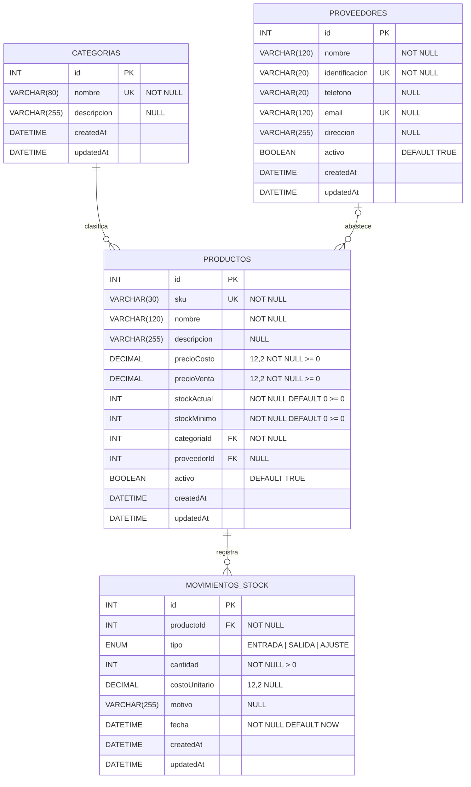

# Mini Proyecto 1 · Día 1 — Sistema de Gestión de Inventarios para PYMES

## 1. Tema y justificación empresarial

Muchas pequeñas y medianas empresas comerciales controlan su inventario en hojas de cálculo o cuadernos. Esto provoca faltantes de productos de alta rotación, sobrecompras, pérdidas que nadie detecta y ningún registro de quién surte cada artículo.

El **Sistema de Gestión de Inventarios** centraliza el catálogo de productos y lo organiza por **categorías**. Vincula cada producto con su **proveedor** y registra cada **entrada, salida o ajuste de stock** en un historial que se puede revisar.

**Beneficios para la empresa:**

- Conoce en todo momento sus existencias reales y el valor del inventario (`stockActual × precioCosto`).
- Identifica productos por debajo del stock mínimo y sabe a qué proveedor comprarlos.
- Reconstruye el historial de cada producto para conciliar diferencias y detectar pérdidas.
- Reduce capital inmovilizado y ventas perdidas, con decisiones de compra basadas en datos.

> Alcance: el sistema se enfoca únicamente en CRUDs completos. No incluye autenticación, login, registro, tokens ni roles.

## 2. Modelo entidad-relación



### Relaciones

| Relación | Cardinalidad | Al eliminar el padre | Motivo |
|---|---|---|---|
| Categorías → Productos | 1 : N (obligatoria) | `RESTRICT` | No se borra una categoría con productos asociados |
| Proveedores → Productos | 1 : N (opcional) | `SET NULL` | El producto se conserva aunque se elimine el proveedor |
| Productos → Movimientos de stock | 1 : N | `RESTRICT` | El historial de inventario es auditoría y no se pierde |

### Reglas de integridad

- **Únicos:** `Categorias.nombre`, `Proveedores.identificacion`, `Proveedores.email`, `Productos.sku`. Un duplicado responde **409 Conflict**.
- **CHECK en MySQL:** precios y stock `>= 0`; `MovimientosStock.cantidad > 0`.
- **Validación en el backend:** campos obligatorios, tipos (texto, número, entero, booleano), longitudes máximas y existencia de las claves foráneas. Un error responde **400 Bad Request**.
- **Índice** `(productoId, fecha)` en movimientos para consultar el historial de un producto.

## 3. Estructura del repositorio

```
Miniproyecto1Backend/
├── backend/
│   ├── .sequelizerc            → rutas de sequelize-cli hacia src/
│   ├── .env.example
│   └── src/
│       ├── config/             → conexión a MySQL (lee .env)
│       ├── database/migrations → migraciones de las 4 tablas
│       ├── models/             → modelos Sequelize y relaciones
│       ├── controllers/        → lógica CRUD + validaciones
│       ├── routes/             → rutas /api/<recurso>
│       ├── middlewares/        → 404 y manejo centralizado de errores
│       ├── utils/              → validadores reutilizables
│       ├── app.js              → configuración de Express
│       └── server.js           → arranque del servidor
├── frontend/src/{components,pages,services}
└── docs/
```

## 4. Endpoints implementados (Día 1)

| Método | Ruta | Respuesta |
|---|---|---|
| POST | `/api/categorias` | 201 con el registro creado · 400 · 409 |
| GET | `/api/categorias` | 200 con el arreglo |
| GET | `/api/categorias/:id` | 200 · 404 |
| PUT | `/api/categorias/:id` | 200 con el registro actualizado · 400 · 404 |
| DELETE | `/api/categorias/:id` | 200 · 404 · 409 si tiene productos |
| POST / GET / GET :id / PUT / DELETE | `/api/productos` | Igual, e incluye la categoría y el proveedor relacionados |
