# Modelo entidad-relación · 20 tablas

Sistema de Gestión de Inventarios para PYMES. Las 20 tablas tienen CRUD completo en la API (`/api/<recurso>`) y en la administración de React.

## Diagrama

Por legibilidad solo se muestran la clave primaria, las claves foráneas y los campos principales. Todas las tablas tienen además `createdAt` y `updatedAt` (en Usuarios, `fechaCreacion`).

```mermaid
erDiagram
    USUARIOS ||--o{ MOVIMIENTOS_STOCK : "registra"
    USUARIOS ||--o{ ORDENES_COMPRA : "registra"
    USUARIOS ||--o{ VENTAS : "registra"
    USUARIOS |o--o| EMPLEADOS : "pertenece a"

    CATEGORIAS ||--o{ PRODUCTOS : "clasifica"
    PROVEEDORES |o--o{ PRODUCTOS : "abastece"
    MARCAS |o--o{ PRODUCTOS : "fabrica"
    UNIDADES_MEDIDA |o--o{ PRODUCTOS : "mide"
    IMPUESTOS |o--o{ PRODUCTOS : "grava"

    PRODUCTOS ||--o{ MOVIMIENTOS_STOCK : "registra"
    PRODUCTOS ||--o{ LOTES : "tiene"
    PRODUCTOS ||--o{ DETALLES_ORDEN_COMPRA : "se pide en"
    PRODUCTOS ||--o{ DETALLES_VENTA : "se vende en"

    BODEGAS ||--o{ UBICACIONES : "contiene"
    BODEGAS |o--o{ MOVIMIENTOS_STOCK : "ocurre en"
    BODEGAS ||--o{ ORDENES_COMPRA : "recibe"

    PROVEEDORES ||--o{ CONTACTOS_PROVEEDOR : "tiene"
    PROVEEDORES ||--o{ ORDENES_COMPRA : "recibe"
    ORDENES_COMPRA ||--|{ DETALLES_ORDEN_COMPRA : "contiene"

    CLIENTES ||--o{ VENTAS : "compra"
    METODOS_PAGO ||--o{ VENTAS : "se paga con"
    VENTAS ||--|{ DETALLES_VENTA : "contiene"

    DEPARTAMENTOS ||--o{ EMPLEADOS : "agrupa"

    USUARIOS { INT id PK
        VARCHAR nombre
        VARCHAR correo UK
        VARCHAR password "hash bcrypt" }
    CATEGORIAS { INT id PK
        VARCHAR nombre UK }
    PROVEEDORES { INT id PK
        VARCHAR nombre
        VARCHAR identificacion UK
        VARCHAR email UK }
    MARCAS { INT id PK
        VARCHAR nombre UK
        VARCHAR paisOrigen }
    UNIDADES_MEDIDA { INT id PK
        VARCHAR nombre UK
        VARCHAR abreviatura UK }
    IMPUESTOS { INT id PK
        VARCHAR nombre UK
        DECIMAL porcentaje "0 a 100" }
    PRODUCTOS { INT id PK
        VARCHAR sku UK
        DECIMAL precioCosto
        DECIMAL precioVenta
        INT stockActual
        INT stockMinimo
        INT categoriaId FK
        INT proveedorId FK
        INT marcaId FK
        INT unidadMedidaId FK
        INT impuestoId FK }
    MOVIMIENTOS_STOCK { INT id PK
        INT productoId FK
        INT bodegaId FK
        INT usuarioId FK
        ENUM tipo "ENTRADA SALIDA AJUSTE"
        INT cantidad }
    BODEGAS { INT id PK
        VARCHAR nombre UK
        BOOLEAN activa }
    UBICACIONES { INT id PK
        INT bodegaId FK
        VARCHAR codigo "único por bodega" }
    LOTES { INT id PK
        INT productoId FK
        VARCHAR codigo "único por producto"
        DATE fechaVencimiento
        INT cantidad }
    CONTACTOS_PROVEEDOR { INT id PK
        INT proveedorId FK
        VARCHAR nombre
        VARCHAR cargo }
    ORDENES_COMPRA { INT id PK
        VARCHAR numero UK
        INT proveedorId FK
        INT bodegaId FK
        INT usuarioId FK
        ENUM estado }
    DETALLES_ORDEN_COMPRA { INT id PK
        INT ordenCompraId FK
        INT productoId FK
        INT cantidad
        DECIMAL costoUnitario }
    CLIENTES { INT id PK
        VARCHAR nombre
        VARCHAR identificacion UK }
    METODOS_PAGO { INT id PK
        VARCHAR nombre UK }
    VENTAS { INT id PK
        VARCHAR numero UK
        INT clienteId FK
        INT metodoPagoId FK
        INT usuarioId FK
        ENUM estado }
    DETALLES_VENTA { INT id PK
        INT ventaId FK
        INT productoId FK
        INT cantidad
        DECIMAL precioUnitario
        DECIMAL descuento "0 a 100" }
    DEPARTAMENTOS { INT id PK
        VARCHAR nombre UK }
    EMPLEADOS { INT id PK
        VARCHAR identificacion UK
        INT departamentoId FK
        INT usuarioId FK "único, opcional"
        DECIMAL salario }
```

## Tablas por área

| # | Tabla | Área | Recurso de la API | Se relaciona con |
|---|---|---|---|---|
| 1 | Usuarios | Personal | `/api/usuarios` (+ `/api/auth`) | Movimientos, órdenes, ventas, empleados |
| 2 | Categorías | Inventario | `/api/categorias` | Productos |
| 3 | Proveedores | Compras | `/api/proveedores` | Productos, contactos, órdenes de compra |
| 4 | Productos | Inventario | `/api/productos` | Categoría, proveedor, marca, unidad, impuesto |
| 5 | Movimientos de stock | Inventario | `/api/movimientos` | Producto, bodega, usuario |
| 6 | Marcas | Inventario | `/api/marcas` | Productos |
| 7 | Unidades de medida | Inventario | `/api/unidades-medida` | Productos |
| 8 | Impuestos | Inventario | `/api/impuestos` | Productos |
| 9 | Bodegas | Bodegas | `/api/bodegas` | Ubicaciones, movimientos, órdenes de compra |
| 10 | Ubicaciones | Bodegas | `/api/ubicaciones` | Bodega |
| 11 | Lotes | Inventario | `/api/lotes` | Producto |
| 12 | Contactos de proveedor | Compras | `/api/contactos-proveedor` | Proveedor |
| 13 | Órdenes de compra | Compras | `/api/ordenes-compra` | Proveedor, bodega, usuario |
| 14 | Detalle de orden de compra | Compras | `/api/detalles-orden-compra` | Orden de compra, producto |
| 15 | Clientes | Ventas | `/api/clientes` | Ventas |
| 16 | Métodos de pago | Ventas | `/api/metodos-pago` | Ventas |
| 17 | Ventas | Ventas | `/api/ventas` | Cliente, método de pago, usuario |
| 18 | Detalle de venta | Ventas | `/api/detalles-venta` | Venta, producto |
| 19 | Departamentos | Personal | `/api/departamentos` | Empleados |
| 20 | Empleados | Personal | `/api/empleados` | Departamento, usuario |

## Reglas al eliminar

| Si se borra… | Y tiene… | Resultado |
|---|---|---|
| Categoría, marca, unidad, impuesto | Productos | **409** (`RESTRICT`) |
| Proveedor | Productos | **409** (lo valida el controller) |
| Proveedor | Contactos | Se borran con él (`CASCADE`) |
| Producto | Movimientos, lotes o líneas de compra/venta | **409** |
| Bodega | Ubicaciones, movimientos u órdenes | **409** |
| Cliente o método de pago | Ventas | **409** |
| Orden de compra / venta | Sus líneas de detalle | Se borran con ella (`CASCADE`, el detalle es parte del documento) |
| Departamento | Empleados | **409** |
| Usuario | Movimientos, órdenes, ventas, empleado | Se conservan sin responsable (`SET NULL`); **409** si es la cuenta en uso |

## Restricciones en la base de datos

- **Únicos:** correos, identificaciones, SKU, nombres de catálogo, números de orden y de factura, `(bodegaId, codigo)` en ubicaciones, `(productoId, codigo)` en lotes, y un producto por documento en cada detalle.
- **CHECK:** precios, costos, stock, salario y cantidades de lote ≥ 0; cantidades de detalle ≥ 1; porcentajes de impuesto y descuento entre 0 y 100.
- **Validación en el backend:** obligatorios, tipos estrictos, longitudes, formatos (email, teléfono, fecha), enums y existencia de cada clave foránea antes de guardar (400).
